<picture><source media="(prefers-color-scheme: dark)" srcset="assets/hero-dark.svg"></picture>

  <a href="https://portfolio-nu-amber-p12k7alk48.vercel.app/"><b>Portfolio</b></a> &nbsp;·&nbsp;
  <a href="https://www.linkedin.com/in/sachinkavishka001/"><b>LinkedIn</b></a> &nbsp;·&nbsp;
  <a href="mailto:sachinkavishka001@gmail.com"><b>Email</b></a>

 

<picture><source media="(prefers-color-scheme: dark)" srcset="assets/about-dark.svg"></picture>

  

<picture><source media="(prefers-color-scheme: dark)" srcset="assets/work-dark.svg"></picture>

  &emsp;

  &emsp;

  &emsp;

Also on GitHub — <a href="https://github.com/D-Sachin/FinanceTrackerApp">Finance Tracker</a> and <a href="https://github.com/D-Sachin/Mobile-App">Pizza Shop App</a>, Android apps in Kotlin.

 

<picture><source media="(prefers-color-scheme: dark)" srcset="assets/marquee-dark.svg"></picture>

  

<picture><source media="(prefers-color-scheme: dark)" srcset="assets/stack-dark.svg"></picture>

  

  <a href="https://portfolio-nu-amber-p12k7alk48.vercel.app/">Portfolio</a> &nbsp;·&nbsp;
  <a href="https://www.linkedin.com/in/sachinkavishka001/">LinkedIn</a> &nbsp;·&nbsp;
  <a href="mailto:sachinkavishka001@gmail.com">sachinkavishka001@gmail.com</a>

