<a href="https://sachin-kavishka.vercel.app/">Portfolio</a> &nbsp;·&nbsp; <a href="https://www.linkedin.com/in/sachinkavishka001/">LinkedIn</a> &nbsp;·&nbsp; <a href="mailto:sachinkavishka001@gmail.com">sachinkavishka001@gmail.com</a>

  &emsp;

  &emsp;

  &emsp;

Also on GitHub — <a href="https://github.com/D-Sachin/FinanceTrackerApp">Finance Tracker</a> and <a href="https://github.com/D-Sachin/Mobile-App">Pizza Shop App</a>, Android apps in Kotlin.

<a href="https://sachin-kavishka.vercel.app/">Portfolio</a> &nbsp;·&nbsp; <a href="https://www.linkedin.com/in/sachinkavishka001/">LinkedIn</a> &nbsp;·&nbsp; <a href="mailto:sachinkavishka001@gmail.com">sachinkavishka001@gmail.com</a>

